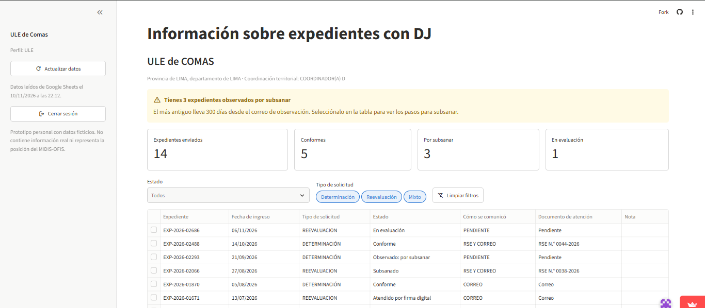
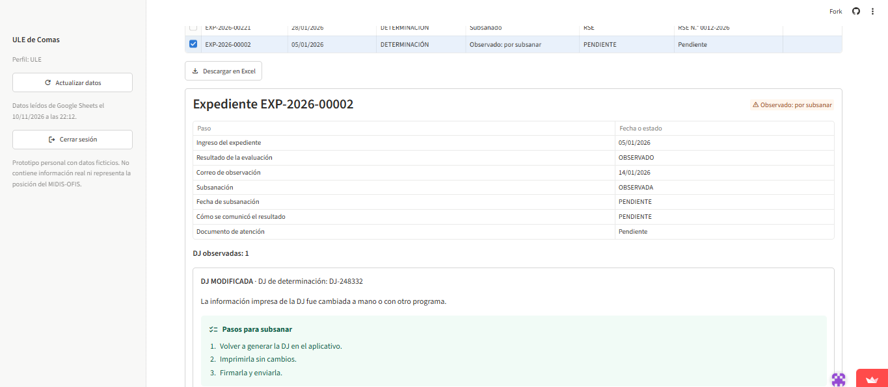
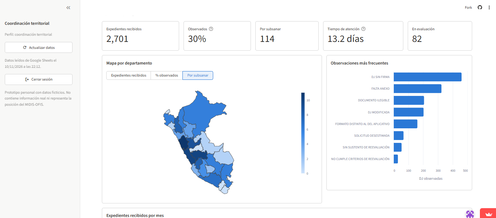
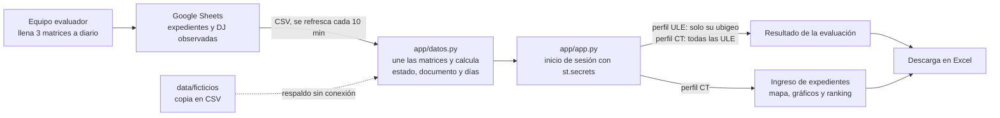

# Info ExpeDJ

**Información sobre expedientes con DJ**: un tablero para que las municipalidades sepan el estado de atención de cada expediente con DJ que envían a una entidad, para que sean evaluadas y procesadas. A través de este tablero, ya no será necesario que las municipalidades consulten a su Coordinador sobre el estado de su expediente.

> Prototipo personal con datos ficticios. No contiene información real ni representa la posición del MIDIS-OFIS.

**Demo:** https://info-expedj-cap.streamlit.app/

## 1. One-liner

**Hacemos que las Unidades Locales de Empadronamiento (ULE) de las municipalidades sepan en qué estado está cada expediente con Declaraciones Juradas (DJ) que envían para ser evaluadas y procesadas, sin tener que preguntarle a su coordinador, mediante un dashboard con dos perfiles (ULE y coordinación) que se alimenta de las matrices de trabajo que el área encargada ya llena en Google Sheets.**

Como resultado de la evaluación, el expediente puede salir conforme u observado. Cuando sale observado, se envía un correo con el motivo de la observación y cómo subsanarlo. El tablero muestra esa misma información aunque la ULE no haya visto el correo.

## 2. Founder

**Claudia Pérez** ([@Clandra91](https://github.com/Clandra91)). Trabajo en el equipo que evalúa los expedientes con DJ que envían las ULE: llenamos estas matrices todos los días y vemos llegar las consultas cuando una ULE no sabe el estado de su expediente. Conozco el proceso desde adentro, y en la Diplomatura de Ciencia de Datos (Q-Lab PUCP) aprendí a convertir esas matrices en tableros y mapas con Python.

## 3. Problema

**Quién lo sufre.**
- El personal de las ULE: envía expedientes con DJ y no tiene dónde ver si ya se evaluaron, si salieron observados o cómo subsanarlos.
- Los coordinadores territoriales (CT): dan asistencia técnica a las ULE y reciben sus consultas.
- Detrás de ellos, los hogares, que esperan el resultado para postular a los programas sociales.

**Cómo se resuelve hoy.** La información existe, pero solo viaja de persona a persona:

1. El ciudadano le pregunta a la ULE.
2. La ULE le pregunta al CT por WhatsApp, por llamada o por correo.
3. El CT le pregunta al área que evalúa y luego le responde a la ULE.

No hay un reporte consolidado: cada CT solo conoce los expedientes que revisa.

**Cuánto le cuesta.**
- **Consultas diarias.** "No hay día en que no me pregunten" (CT 1). Las consultas aumentan cuando los programas sociales cierran postulaciones.
- **Esperas.** La respuesta depende de la agenda del CT: si está en reuniones o en otra asistencia técnica, la ULE espera.
- **Correos que nadie ve.** Muchas ULE no ven el correo de observación a tiempo: "lo vi después de 3 días" (ULE). Además, por la rotación de personal, quien llega no conoce el historial.
- **Seguimiento a ciegas.** Hoy la ULE deduce el estado de su expediente revisando si la clasificación socioeconómica de sus hogares ya se actualizó. Si no, le pregunta a su CT. Le toma alrededor de 1 hora a la semana, "pero depende, porque si le consulto a mi coordinador, demora más tiempo" (ULE). Además, lleva su propio registro en Excel.
- **Dudas que se repiten.** El motivo de la observación, qué corregir, cómo subsanar, si hay que reenviar la DJ y cuánto tiempo queda (CT 2).
- **Hogares sin clasificación.** Mientras el expediente demora o está observado, los hogares "no obtienen su clasificación" (ULE).
- **Estimación propia, por validar.** Si un CT atiende 5 consultas al día y cada una le toma 10 minutos entre buscar el expediente, preguntar y responder, pierde más de 4 horas a la semana en reenviar información que ya está en las matrices.

**Evidencia: 3 conversaciones con usuarios potenciales** (anónimas, con consentimiento):

- [Conversación 1: coordinador(a) territorial](docs/research/conversacion_1_ct.md)
- [Conversación 2: coordinador(a) territorial](docs/research/conversacion_2_ct.md)
- [Conversación 3: personal de una ULE](docs/research/conversacion_3_ULE.md)

Lo que pidió la ULE, con sus palabras: "una página donde pueda ver el estado real de mi expediente, si se atendió ok o fue observado".

## 4. Solución e insight

**Solución.** Un tablero con inicio de sesión y dos perfiles:

| Perfil | Qué ve |
|---|---|
| **ULE** | Solo sus expedientes. Al entrar, un aviso con los observados por subsanar y los días que llevan, aunque no haya visto el correo. Indicadores, una tabla con filtros de estado y tipo de solicitud, y el detalle de cada expediente: su recorrido, el documento con que se le respondió (RSE, oficio o correo), la nota del expediente y, por cada DJ observada, el motivo, el detalle y los pasos para subsanar. Descarga en Excel. |
| **Coordinación territorial (CT)** | Lo mismo para cualquier ULE, buscándola por ubigeo o por nombre. Además, una pestaña de ingreso de expedientes con filtros (fecha de ingreso, CT, tipo, ubigeo, departamento, provincia y distrito): indicadores, mapa por departamento, observaciones más frecuentes, expedientes por mes y un ranking de las ULE que conviene priorizar en la asistencia técnica. Descarga en Excel. |

**Insight.** El problema no es que falten datos: el equipo ya llena tres matrices todos los días. El problema es que esa información solo llega a la ULE a través de personas. Si se muestra la misma matriz con permisos por perfil, las consultas de ida y vuelta desaparecen **sin sumarle trabajo a nadie**, que era la condición del CT 1 ("requeriría incluir una actividad más"). Y como las observaciones se repiten, los pasos para subsanar se escriben una vez por criterio y le sirven a todo el personal nuevo de las ULE.

## 5. Why now

- **Los datos ya son digitales.** Las matrices viven en Google Sheets y se actualizan a diario: no hay que digitar nada nuevo.
- **Publicar cuesta casi nada.** Streamlit Community Cloud despliega un tablero con usuarios y claves en minutos y gratis. Hace tres años esto requería un servidor y un equipo de TI.
- **Una persona del área lo puede construir.** Con un agente de programación (Claude Code) armé el prototipo en dos días sin ser programadora.
- **La necesidad crece.** Por la rotación de personal en las ULE, cada vez hay más gente nueva que necesita información sin depender de alguien que la recuerde. Además, Y Combinator pide hoy startups de *AI for City Hall*: herramientas para los trámites de las municipalidades.

## 6. Demo

**URL pública:** https://info-expedj-cap.streamlit.app/

**Video de respaldo (1:49):** <https://drive.google.com/file/d/1OqVjQm88GeUEwalDTqj87rqPM6ISS_e9/view?usp=drive_link>

| Perfil | Usuario | Contraseña |
|---|---|---|
| ULE de Comas | `ule_comas` | `comas2026` |
| ULE de Huanta | `ule_huanta` | `huanta2026` |
| Coordinación territorial | `coordinador` | `ct2026` |

Son usuarios de prueba creados solo para este prototipo con datos ficticios.

**Recorrido sugerido:**
1. Entra como `ule_comas`: verás el aviso de 3 expedientes por subsanar.
2. Selecciona uno en la tabla para ver el motivo y los pasos para subsanar.
3. Cierra sesión y entra como `coordinador`. Abre "Ingreso de expedientes" y filtra por departamento o por fechas.

**Capturas**

| La ULE ve sus expedientes | Detalle y pasos para subsanar | La coordinación ve el territorio |
|---|---|---|
|  |  |  |

**Arquitectura**



**Tecnologías y por qué**

| Tecnología | Para qué | Por qué |
|---|---|---|
| Google Sheets (exportación CSV) | Fuente de datos | Las matrices ya se llenan ahí: el tablero no agrega trabajo. |
| Streamlit + `st.secrets` | Tablero, inicio de sesión y perfiles | Dashboards en Python y despliegue gratuito. Las claves no van en el repo. |
| Plotly + GeoJSON del Perú | Mapa por departamento | Muestra dónde se concentran los observados para priorizar la asistencia técnica. |
| Altair | Gráficos de barras | Se integra con el tema de Streamlit. |
| pandas + XlsxWriter | Cálculos y descarga en Excel | Todos los usuarios trabajan en Excel; el ubigeo se guarda como texto para no perder el 0 inicial. |

**No usa modelos de lenguaje.** Los datos son estructurados y las reglas son fijas: un LLM agregaría costo y riesgo de error sin mejorar la respuesta. Más adelante, un LLM podría resumir el estado de cada ULE para preparar la asistencia técnica (ver "Qué sigue").

## 7. Modelo de negocio

**Quién paga:** la OFIS del MIDIS, que evalúa los expedientes. Los usuarios son las ULE de las 1,891 municipalidades del país (RENAMU 2026) y los CT.

| Concepto | Precio |
|---|---:|
| Implementación: conexión segura a las matrices reales, inicio de sesión institucional y capacitación a CT y ULE | S/ 8,000 (una vez) |
| Suscripción: servidor, mantenimiento, soporte y mejoras | S/ 1,000 al mes |
| **Primer año** | **S/ 20,000** |

**Por qué ese precio.** El primer año queda por debajo de 8 UIT (S/ 44,000 con la UIT 2026 de S/ 5,500), el tope de las contrataciones menores de la Ley 32069. Así la entidad puede contratarlo sin un proceso de selección largo.

**Cuánto cuesta cada usuario.**
- **Tokens:** S/ 0, porque no usa modelos de lenguaje.
- **Servidor:**
  - Prototipo: gratis en Streamlit Community Cloud.
  - Producción: un servidor pequeño cuesta unos US$ 20 al mes (≈ S/ 75). Repartido entre las 1,891 ULE, son ≈ S/ 0.04 por ULE al mes.
- **Datos:** Google Sheets no suma costo, porque ya se usa.

Casi toda la suscripción paga soporte y mejoras, no infraestructura.

**Nota.** Como trabajo en la entidad, en la práctica no podría venderle este servicio (Ley 32069, art. 30): se implementaría como un proyecto interno. El precio muestra cuánto vale el producto y sirve de referencia para replicarlo en otras entidades que reciben expedientes de las municipalidades.

## 8. Herramientas del curso

| Herramienta | Sesión | Qué hace en el producto | Archivos |
|---|---|---|---|
| Dashboards con Streamlit | 05 | Inicio de sesión con dos perfiles, indicadores, filtros, tabla con detalle del expediente y descarga en Excel | [`app/app.py`](app/app.py), [`app/vistas.py`](app/vistas.py), [`app/datos.py`](app/datos.py), [`.streamlit/config.toml`](.streamlit/config.toml) |
| Mapas | 06 | Mapa del Perú por departamento: expedientes recibidos, % observados o por subsanar | [`app/vistas.py`](app/vistas.py) (función `mapa_departamentos`), [`data/geo/peru_departamental_simple.geojson`](data/geo/peru_departamental_simple.geojson) |

**Por qué esas dos.**
- **El dashboard** responde la necesidad de las tres conversaciones: información actualizada y centralizada que cada usuario consulte por su cuenta. Es lo que pidió la ULE: "una página donde pueda ver el estado real de mi expediente".
- **El mapa** responde la pregunta del CT: dónde se concentran los observados, para decidir a quién dar asistencia técnica primero.

## 9. Qué hizo el agente

Construí el prototipo con **Claude Code** como guía, paso a paso.

**Lo que hice yo:**
- Definí el problema, los perfiles y lo que ve cada uno.
- Definí las reglas de las matrices (estados, "PENDIENTE", "NO REQUIERE", cuándo se informa por correo), los nombres genéricos de las columnas, los filtros, la descarga en Excel y el título.
- Hice las conversaciones con los usuarios.
- Creé cada archivo, pegué y revisé el código, e hice los commits y la publicación.

**Lo que generó Claude Code:**
- El script de datos ficticios.
- El código del tablero (`app.py`, `datos.py`, `vistas.py`) y el tema de colores.
- La prueba de cada cambio en una copia aparte, con un navegador automatizado, antes de pasármelo.
- Me ayudó a anonimizar las notas de las conversaciones y a redactar este README.

## Datos y privacidad

- **Todos los datos son ficticios.**
  - [`data/generar_datos_ficticios.py`](data/generar_datos_ficticios.py) (semilla 2027) crea 2,701 expedientes de 852 municipalidades de los 25 departamentos.
  - Las municipalidades se eligen al azar del [RENAMU 2026](data/referencia/renamu_indicadores_2024_2026.csv) (INEI, público).
  - Las 3 matrices están en una hoja pública de Google Sheets que solo tiene estos datos. La copia en CSV está en `data/ficticios/`.
- **Nada interno.** No hay datos de personas ni información interna, y las columnas llevan nombres genéricos.
- **Claves fuera del repo.** Los usuarios y claves de prueba están en los *secrets* de Streamlit Cloud. `.streamlit/secrets.toml` está en `.gitignore`.
- **En la versión real:**
  - Inicio de sesión con cuentas institucionales (`st.login`).
  - Matrices privadas, leídas con una cuenta de servicio.
  - La misma regla que ya cumple el prototipo: cada ULE ve solo su ubigeo.

## Cómo correrlo en local

```bash
uv sync
uv run streamlit run app/app.py
```

Antes, crea `.streamlit/secrets.toml` con los usuarios. Por ejemplo:

```toml
[usuarios.ule_comas]
clave = "comas2026"
perfil = "ULE"
ubigeo = "150110"
etiqueta = "ULE de Comas"
```

Para volver a generar los datos ficticios: `uv run python data/generar_datos_ficticios.py`.

## Qué sigue

1. **Prueba con usuarios:** que los 2 CT y una ULE lo usen y ajustar lo que no se entienda.
2. **Seguridad para datos reales:** inicio de sesión institucional y matrices privadas.
3. **Avisos:** un correo o mensaje a la ULE cuando un expediente pasa a observado.
4. **Resumen con IA (sesión 08):** el estado de cada ULE en un párrafo, para preparar la asistencia técnica.
5. **Réplica:** llevarlo a otras entidades que reciben expedientes de las municipalidades.